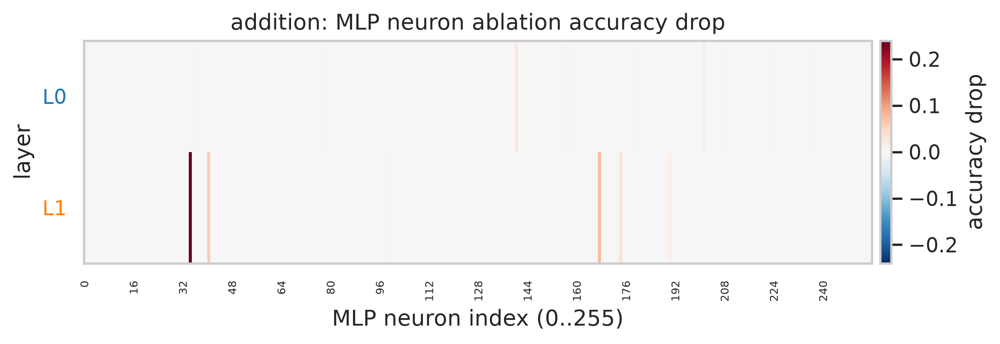

# MechInterpLens

MechInterpLens is a starting point for **mechanistic interpretability** ("mechinterp") projects on small transformer models. Built on [TransformerLens](https://github.com/TransformerLensOrg/TransformerLens).

[](LICENSE)
[](pyproject.toml)
[](https://colab.research.google.com/github/aditeyabaral/MechInterpLens/blob/main/examples/quickstart.ipynb)



*A 2-layer model trained on single-digit addition. Each cell is how much accuracy drops when that MLP
neuron is switched off: out of 512 neurons, only a handful matter.* **[Try it in Colab](https://colab.research.google.com/github/aditeyabaral/MechInterpLens/blob/main/examples/quickstart.ipynb)**:
the whole workflow on that example, in a few minutes.

**What you get:** 

Train a tiny transformer on a task you design, then find the neurons and attention heads that drive it. 

- **Build the model:** a tokenizer, a dataset and a small GPT-2 trained on your task.
- **Look inside it:** the activations of every neuron and head at each answer token, and sparse probes
  that shortlist the ones that carry information.
- **Test what it needs:** intervene on each component, measure the accuracy drop,
  and draw the circuit of the ones that matter.

It finds *which* neurons and attention heads matter, and *how much*; working out *how* they do their
job is the research you do next ([concepts](docs/concepts.md),
[after the sweep](docs/after-the-sweep.md)). Everything generic already works; the task-specific
parts are clearly marked `TODO`s. New to mechinterp? Start with the [documentation](docs/README.md).

## Quickstart

**In your browser:** [open the quickstart in Colab](https://colab.research.google.com/github/aditeyabaral/MechInterpLens/blob/main/examples/quickstart.ipynb).
It runs the whole workflow on the template's example task, single-digit addition.

**On your machine,** with [`uv`](https://docs.astral.sh/uv/):

```bash
git clone https://github.com/aditeyabaral/MechInterpLens.git && cd MechInterpLens
uv sync                       # create the virtual environment and install dependencies
uv run python src/main.py -h  # check it works (prints the command-line options)
```

Then fill in the `TODO`s for your task and follow the workflow below. To try the example task
locally instead, run `uv run python scripts/fill_example.py .` **in a copy** of the repository (it
edits the files in place). Everything is saved locally by default; to also push to the Hugging Face
Hub, log in once with `uv run hf auth login` and pass `--hub-name`.

## Workflow

Steps 1–3 build your toy model; steps 4–7 study it:

```
  train_tokenizer.py  ──▶  create_dataset.py  ──▶  train_model.py  ──▶  your toy model
   (build a tokenizer)      (make training data)    (train it)          (saved locally, or to the Hub)
                                                                                │
                                                                                ▼
  PromptDataset  ──▶  main.py  ──▶  results file  ──▶  lasso.py  ──▶  lasso_shortlist.json
   (probe prompts)    (capture)     (activations)       (rank parts)    (what to ablate)
        │                                                                     │
        └──────────▶  main.py --intervention  ◀───────────────────────────────┘
                      (switch the parts off -- the shortlist, or `all` of them --
                       save baseline + ablated runs)
                              │
                              ▼
                      plot_ablations.py  (visualise the drops: heatmaps + scatter)
```

| Step | What it does | Command | Details |
| --- | --- | --- | --- |
| 1. Tokenizer | one token per character, checked before saving | `uv run python src/train/train_tokenizer.py` | [building](docs/building-a-model.md#1-build-a-tokenizer) |
| 2. Dataset | train and validation splits, checked for leakage | `uv run python src/train/create_dataset.py` | [building](docs/building-a-model.md#2-generate-a-dataset) |
| 3. Train | a small GPT-2, evaluated by exact match | `uv run python src/train/train_model.py` | [building](docs/building-a-model.md#3-train-the-toy-model) |
| 4. Prompts | the prompts you study the model on | implement `PromptDataset.generate_prompts` | [analysing](docs/analysing-a-model.md#4-define-your-probe-prompts) |
| 5. Capture | record activations at every answer token | `uv run python src/main.py -m saved_models --capture-activations` | [analysing](docs/analysing-a-model.md#5-capture-activations) |
| 6. Shortlist *(optional)* | sparse probes rank neurons and heads | `uv run python src/analysis/lasso.py --dir .` | [analysing](docs/analysing-a-model.md#6-find-the-important-components-optional) |
| 7. Ablate | switch each component off, measure the accuracy drop, plot it | `uv run python src/main.py -m saved_models --intervention all` | [analysing](docs/analysing-a-model.md#7-ablate-them-optional) |

Steps 6 and 7 are optional: you can stop after capturing and explore the saved activations yourself.
For a small model you can also skip the shortlist: `--intervention all` switches off every neuron
and head, one at a time.

## What you need to fill in

Every spot you might edit is marked with a `TODO` (`grep -rn TODO src/` lists them):

| File | What to implement | When |
| --- | --- | --- |
| `src/train/train_tokenizer.py` | `VOCAB_CHARS`, `SAMPLE_TEXTS` | building the model |
| `src/train/create_dataset.py` | `build_dataset`: your training data; `item_key` for the leakage check (optional) | building the model |
| `src/train/train_model.py` | `TOKENIZER_NAME`, `DATASET_NAME`; `eval_categories` for per-category accuracy (optional) | building the model |
| `src/utils/dataset.py` | `PromptDataset.generate_prompts`: the probe prompts | **required to analyse** |
| `src/inference.py` | `find_answer_span`: which substring is "the answer" | optional (good default) |
| `src/inference.py` | `find_positions_of_interest`: extra prompt positions to record (gets each prompt's metadata) | optional (default: none) |
| `src/utils/parser.py` | extra task-specific command-line arguments | optional |
| `src/utils/dir.py` | `generate_output_path`: the output filename | optional (good default) |
| `src/analysis/lasso.py` | `keep_row`, `assign_condition`, `build_target`: which rows, what to compare/predict | optional (good defaults) |

Each `TODO` explains what to do and shows a worked example in comments. See
[customising](docs/customising.md) for tips, pretrained models and non-GPT-2 models.

## Project structure

```
src/
  train/                 # build your toy model
    train_tokenizer.py   #   build a character-level tokenizer            [fill in vocab]
    create_dataset.py    #   generate a synthetic training dataset        [fill in build_dataset]
    train_model.py       #   train a small GPT-2, saved locally by default [fill in names]
    scoring.py           #   is_correct(): the answer's exact tokens, then <eos> (used everywhere)
  model.py               # load_model(): boots the model into a TransformerLens bridge (generic)
  utils/
    dataset.py           # PromptDataset: the probe prompts you run            [fill in, required]
    parser.py            # command-line arguments for main.py                  [optional extra args]
    dir.py               # builds the output filename                          [optional]
    ablations.py         # shared loaders for intervention .pt files (used by the plot scripts)
    plotting.py          # shared figure helpers (colour maps, save_figure) for the plot scripts
  inference.py           # the activation-capture loop, the heart of the analysis
  main.py                # ENTRY POINT: run capture (+ optional intervention) and save results
  analysis/              # OPTIONAL analysis + plotting scripts (run from the repo root)
    lasso.py             #   rank neurons/heads by importance, write lasso_shortlist.json
    plot_ablations.py    #   heatmaps + cross-run scatter of ablation accuracy drops
    plot_circuits.py     #   circuit diagrams of the surviving components per setting
    split_half.py        #   did a sweep use enough prompts? (stability of its component ranking)
scripts/
  fill_example.py        # fills in the commented example task (used by the Colab notebook and CI)
examples/
  quickstart.ipynb       # the whole workflow on the example task (Open in Colab)
  img/                   # figures used in this README
docs/                    # the full documentation
```

The two files you'll spend the most time *reading* are **`inference.py`** (how activations are
captured) and **`main.py`** (how a run is orchestrated). They are heavily commented.

## Documentation

- [Concepts](docs/concepts.md): a mechinterp primer covering every term the template uses, zero vs
  mean ablation, and what probes can and can't tell you.
- [Building a model](docs/building-a-model.md): steps 1–3 in detail.
- [Analysing a model](docs/analysing-a-model.md): steps 4–7 in detail, including how the sweep is
  scored and how to read the plots.
- [Outputs](docs/outputs.md): what each run saves and how to load it.
- [Customising](docs/customising.md): what to fill in, tips, pretrained and non-GPT-2 models.
- [After the sweep](docs/after-the-sweep.md): from *which* components matter to *how* they work.
- [Reading list](docs/reading.md): papers, guides and courses to go further.

## Citing

If you use MechInterpLens in your work, please cite it: GitHub's **Cite this repository** button
(from [`CITATION.cff`](CITATION.cff)) gives the reference in APA and BibTeX.

## License

[MIT](LICENSE).

## Acknowledgements

This template is built entirely on top of the open-source mechanistic interpretability and
machine-learning ecosystem:

- **[TransformerLens](https://github.com/TransformerLensOrg/TransformerLens)** (originally by Neel
  Nanda, now maintained by the TransformerLens community) provides the hook-based interface this
  template uses for all activation capture and ablation.
- **Hugging Face's `transformers`, `datasets`, `tokenizers`, and `accelerate`** libraries provide the
  tokenizer, dataset, and training infrastructure in `src/train/`.
- **GPT-2** (Radford et al., 2019, OpenAI) is the architecture every toy model in this template is
  based on.
- The overall workflow (train a toy model on a task you understand, then use causal interventions to
  find the circuit behind it) follows the approach popularised by the mechanistic interpretability
  research community (see the [reading list](docs/reading.md)).
