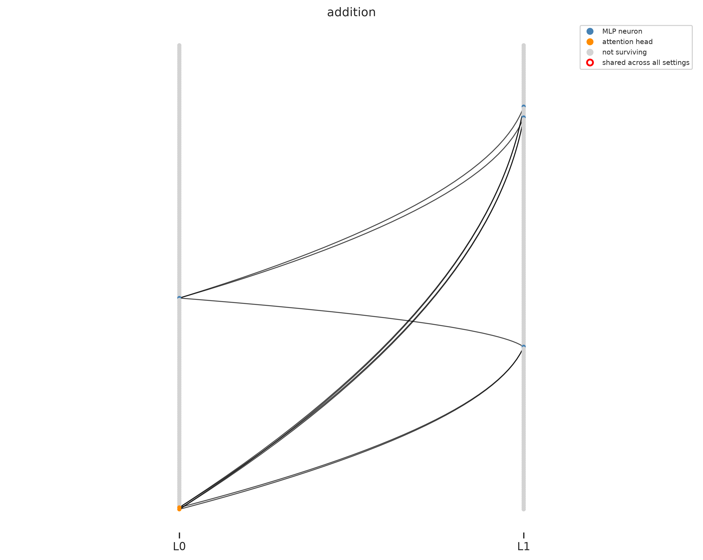

# Analysing a model (steps 4–7)

Steps 4–7 study your model: run it on prompts, record what happens inside, shortlist the components
that look important, and switch them off to test whether the model needs them. The terms are defined
in [concepts](concepts.md); what each run saves is described in [outputs](outputs.md).

## 4. Define your probe prompts

Open `src/utils/dataset.py` and implement `PromptDataset.generate_prompts`. A prompt is just the
input string you feed the model; end it right where you want the answer to begin (e.g. `"7+5="`).
These prompts *are* your experiment: they decide what behaviour you get to study. **This is the one
thing you must implement to run the analysis.** A self-contained example (single-digit addition) is
included in comments: uncomment it to see the pipeline run end to end, then replace it.

Each prompt carries a `metadata` dict with its ground truth; put the correct answer under `"answer"`
(as the example does); scoring and the ablation sweep compare the model's answer against it.

> [!TIP]
> **Trained your own model? Prefer questions it never trained on.** A model is easiest to study on
> questions it has learned to *generalise* to, not ones it may have memorised. One way is to build
> your prompts from your dataset's `validation` split (load it with `datasets.load_dataset`).

## 5. Capture activations

```bash
uv run python src/main.py -m <user>/my-model --num-prompts 200 --capture-activations
```

Capture and ablation both use the model's device, selected automatically in the order CUDA,
Apple Metal (MPS), then CPU. `src/main.py` prints the device and records it in the output metadata.

This runs your model on each prompt, records the activations at every answer token, and saves a
`.pt` file in the current directory (its name is generated automatically from every run parameter, so
different runs never overwrite each other; pass `--output FILE.pt` to choose it yourself). It also
prints the baseline accuracy. Useful options (`python src/main.py -h` lists them all):

| Option | Meaning |
| --- | --- |
| `-m, --model-path` | model to load (your HF repo id, or a local path); **required** |
| `-p, --num-prompts` | how many prompts to run (default 1000) |
| `-l, --layers` | which layer indices to record from, and to ablate with `--intervention all` (default: all) |
| `--capture-activations` | record the activations: residual stream, MLP neurons, heads, embeddings. **Without this flag only the answer itself is saved, so pass it for any real analysis (`lasso.py` needs it).** |
| `--capture-logits` | also save the logits that predict each answer token and the `<eos>` after it (they are big, and can be rebuilt from the last layer's residual stream) |
| `--max-new-tokens` | how many tokens to generate per prompt (default: the longest answer plus one for `<eos>`) |
| `--intervention FILE` | run an ablation sweep from a `lasso_shortlist.json`, or `all` for every neuron and head (step 7) |
| `--ablation-type` | how the sweep switches a component off: `zero` (default) or `mean` |
| `--batch-size` | prompts per forward pass in the teacher-forced sweep (default 256) |

## 6. Find the important components *(optional)*

```bash
uv run python src/analysis/lasso.py --dir . --output lasso_shortlist.json
```

Reads the `.pt` files and, at every captured position and layer, fits a **probe**: a sparse (L1)
logistic regression that tries to predict a target (by default, the next answer token the model
writes) from the activations, trained on 80% of the prompts and scored on the other 20%. The
neurons/heads a probe relies on form the shortlist, written to `lasso_shortlist.json` with their
**weights** and the probe's held-out accuracy; a probe that can't beat chance shortlists nothing.
(See the `lasso.py` module docstring for the exact JSON layout.)

> [!NOTE]
> A probe shows where information can be **read**, which is not the same as what the model **uses**;
> that's what step 7 tests (see [probes](concepts.md#probes-where-information-can-be-read-vs-what-the-model-uses)).
> For a small model you can skip this step and ablate everything (`--intervention all`).

## 7. Ablate them

```bash
uv run python src/main.py -m <user>/my-model --num-prompts 200 --intervention lasso_shortlist.json
uv run python src/main.py -m <user>/my-model --num-prompts 200 --intervention all   # every neuron and head
```

Re-runs the prompts, switching off each important component in turn, and for each one records the
**accuracy drop** it causes (`baseline_accuracy - ablated_accuracy`) into a single `.pt` file: the
bigger the drop, the more the model relied on that component. An answer is correct only if the model
produces exactly the `"answer"` in the prompt's metadata, token for token, and then `<eos>` (a model
that writes the right answer and keeps going has not done the task). This one rule, `is_correct` in
`src/train/scoring.py`, is used everywhere: training picks its best checkpoint by it, and inference
marks every generated answer with it.

### How the sweep is scored (teacher forcing)

Generating every answer token by token, for every prompt, again for every component, is slow. So
each ablated model is scored by *teacher forcing*: the prompt is fed together with its correct answer
and `<eos>`, and a single forward pass shows whether the model's top prediction is right at every
answer step. That gives exactly the same verdict as greedy generation, because the model writes the
right answer iff it predicts each next token right, given the right answer so far; `main.py` checks
this on the baseline and warns if the two ever disagree. It is also much faster: one forward pass per
batch of prompts, instead of one per generated token per prompt. It also tells you **which step** an
ablation breaks: each ablation records `step_accuracy_drop` per answer token (`step0`, `step1`, …)
and for stopping (`eos`).

**A worked example.** Take the prompt `7+5=` (without few-shot examples, to keep it short) and its
answer `12`. Teacher forcing feeds all seven tokens `7 + 5 = 1 2 <eos>` at once. A transformer
predicts the *next* token at every position, so three of those predictions score the answer:

| Position | Input token | Must predict | Step |
| --- | --- | --- | --- |
| 3 | `=` | `1` | `step0` |
| 4 | `1` | `2` | `step1` |
| 5 | `2` | `<eos>` | `eos` |

The answer counts as right only if all three are right. That is exactly when greedy generation
would write `1`, then `2`, then stop: at each step generation feeds back what it just wrote, and if
every prediction so far was right, that is the correct answer, the same input teacher forcing used.
If an ablation breaks only the `eos` row, the model still computes `12` but no longer stops.

### Zero or mean ablation

By default a component is switched off by setting it to 0. In a tiny model that is often a value
the component never takes, so removing almost anything can look harmful. `--ablation-type mean` sets
it to its *average* value instead (over every token of every prompt and its answer), which removes
only what the component says about *this* prompt: a gentler, often more telling test. Running both
and comparing is a good habit; [concepts](concepts.md#zero-vs-mean-ablation) explains why.

### Did you use enough prompts?

To check, run the **split-half check** on a sweep:
`uv run python src/analysis/split_half.py <sweep .pt>`. It measures each component's drop on half the
prompts and on the other half, and compares the two rankings. A value near 1 (for the "meaningful"
components, whose drop is above `--meaningful-drop`, half a percentage point by default) means the
ranking is stable; a low one means you need more `--num-prompts`.

### Plotting the drops

`src/analysis/plot_ablations.py` turns the drops into figures. Like `lasso.py`, it reads a
whole **directory** of intervention runs (each `.pt` in it is one *setting*) and reads the layer
count, head count and MLP size from the files themselves, so there is nothing else to pass:

```bash
uv run python src/analysis/plot_ablations.py --dir <dir with your intervention .pt files> --output plots
```

Into `plots/` it writes:

- **per-run heatmaps**: for each run, a `layer × MLP-neuron` and a `layer × attention-head` heatmap
  of the accuracy drop (grey = a component that run didn't ablate);
- **across-run comparisons** *(only when the directory has ≥2 runs)*: `setting × component` heatmaps
  (read one neuron/head *down a column* to compare it across runs) and, for every pair of runs, a
  **scatter** placing each component at (`its drop in run A`, `its drop in run B`): points on the
  `y=x` line matter equally in both runs, points off it matter in one but not the other. A point's
  shape marks its type (circle = neuron, star = head) and its colour marks its layer.

So a single intervention file already gives you the two per-run heatmaps; to get the comparisons,
capture-and-ablate under two conditions (say, two prompt distributions or two models) and drop both
`.pt` files in the same directory.

`src/analysis/plot_circuits.py` reads the same directory of intervention runs and draws a **circuit
diagram** instead: one column of nodes per layer (all MLP neurons + attention heads), with the
components in the top-p percentile of accuracy drop that also cost something when removed
("survivors") coloured and connected to the survivors of the next layer. It writes one
`circuit_<setting>.png` per setting and, with two or more settings, a `circuit_combined.png`
overlaying every setting's edges in its own colour, with the components that survive in *every*
setting (the shared-circuit candidates) ringed in red. It also prints each setting's survivors layer
by layer, with their accuracy drops (highest first), so the same information is readable in the
terminal:

```bash
uv run python src/analysis/plot_circuits.py --dir <dir with your intervention .pt files> --output plots --percentile 99
```



Both plot scripts take `--metric` to choose which drop they show: `accuracy_drop` (the whole answer,
the default), `mean_step_accuracy_drop` (averaged over the answer steps), or one step, e.g.
`step:step0` (the answer's first token) or `step:eos` (whether the model still stops).

What to make of these figures, and what to do next, is the subject of
[after the sweep](after-the-sweep.md).
